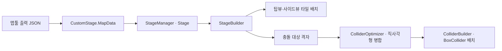

# 맵 데이터 기반 스테이지 빌딩

**담당자:** 최성원 — 맵 출력 데이터 가공·벽 구성·충돌체 병합

## 코드



**CustomStage.MapData:** 두 시점의 타일·제한 영역·아이템·포탈·문 시점 정보를 전달합니다. **StageManager → Stage → StageBuilder:** 맵 데이터를 받아 스테이지를 생성합니다. **ColliderOptimizer → ColliderBuilder:** 격자를 직사각형으로 묶고 충돌체를 배치합니다.

```csharp
// CustomStage.MapData의 핵심 필드 발췌: 빌더가 소비하는 공통 데이터
public char[,] topView, sideView;
public int[,] topBan, sideBan;
public List<CustomStage.ItemData> items;
public List<CustomStage.PortalPair> portalPairs;
public bool useConvert;

// StageManager.StageEnter의 JSON 맵 분기: 기존 배치 씬과 같은 진입 흐름에 연결
private void LoadMapData(Episode episode, int index)
{
    var file = Resources.Load<TextAsset>($"MapData/stage {(int)episode + 1}-{index + 1}");
    if (file == null) throw new InvalidOperationException("맵 데이터를 찾을 수 없습니다.");
    currentStageInfo.newData = JsonConvert.DeserializeObject<CustomStage.MapData>(
        file.text, new Vector3Converter(), new Array2DConverter());
    LoadCustomStage();
}

// StageBuilder.buildStage의 충돌 영역 생성 부분
private void BuildCollisionAreas(CustomStage.MapData map)
{
    topWallBuilder.BuildColliders(map.topView);
    if (!map.useConvert) return;
    sideWallBuilder.BuildColliders(map.sideView);
    topBanBuilder.BuildColliders(map.topBan);
    sideBanBuilder.BuildColliders(map.sideBan);
}
```

```csharp
// StageBuilder의 탑뷰 벽 배치 발췌: 같은 X열의 사이드뷰 벽 구간을 찾아 깊이 배치
// 설명을 줄이기 위해 이 블록은 Wall 타일만 처리한다.
private void BuildTopWalls(char[,] top, char[,] side)
{
    for (int row = 1; row < top.GetLength(0) - 1; ++row)
    for (int x = 0; x < top.GetLength(1); ++x)
    {
        if (top[row, x] != (char)CustomStage.TileType.Wall) continue;
        bool found = false, previousWall = false;
        for (int depth = side.GetLength(0) - 2; depth > 0; --depth)
        {
            bool wall = side[depth, x] == (char)CustomStage.TileType.Wall;
            // 연속된 벽 셀마다 만들지 않고 벽 구간에 들어가는 지점에만 배치한다.
            if (wall && !previousWall)
            {
                topTilemaps[depth - 1].SetTile(new Vector3Int(x, row - 1, 0), wallRuleTile);
                found = true;
            }
            previousWall = wall;
        }
        if (!found)
        {
            // 반대 시점에 없는 벽은 경계 면에 모아 양쪽 투영을 맞춘다.
            topTilemaps[^1].SetTile(new Vector3Int(x, row - 1, 0), wallRuleTile);
            sideTilemaps[row].SetTile(new Vector3Int(x, 7, 0), wallRuleTile);
        }
    }
}
```

```csharp
// ColliderOptimizer: 같은 충돌 영역의 연속 셀을 겹치지 않는 직사각형으로 묶기
// solid는 원본 char/int 맵에서 충돌 대상만 골라 만든 설명용 마스크다.
public static List<GridRect> BuildRects(bool[,] solid)
{
    int rows = solid.GetLength(0), columns = solid.GetLength(1);
    var used = new bool[rows, columns];
    var rectangles = new List<GridRect>();
    for (int y = 0; y < rows; ++y)
    for (int x = 0; x < columns; ++x)
    {
        if (!solid[y, x] || used[y, x]) continue;
        int maxWidth = 0;
        while (x + maxWidth < columns && solid[y, x + maxWidth]
            && !used[y, x + maxWidth]) ++maxWidth;

        int width = maxWidth, height = 1;
        for (int nextY = y + 1; nextY < rows; ++nextY)
        {
            int rowWidth = 0;
            while (rowWidth < maxWidth && solid[nextY, x + rowWidth]
                && !used[nextY, x + rowWidth]) ++rowWidth;
            if (rowWidth == 0) break;
            // 아래 행이 더 좁으면 폭을 줄여 빈 셀을 직사각형에 포함하지 않는다.
            width = Math.Min(width, rowWidth);
            ++height;
        }
        var rectangle = new GridRect(x, y, width, height);
        rectangles.Add(rectangle);
        // 확정한 영역을 사용 처리해 뒤의 직사각형이 같은 셀을 다시 차지하지 않는다.
        for (int dy = 0; dy < height; ++dy)
        for (int dx = 0; dx < width; ++dx) used[y + dy, x + dx] = true;
    }
    return rectangles;
}

// ColliderBuilder.CreateBoxCollider의 일반 벽 위치·크기 계산
private void PlaceWall(GridRect rectangle, bool sideView)
{
    var wall = new GameObject("WallCollider");
    wall.layer = LayerMask.NameToLayer("Platform");
    wall.transform.SetParent(colliderParent);
    float x = rectangle.x + rectangle.width * 0.5f;
    float row = rectangle.y + rectangle.height * 0.5f - 1.5f;
    // 같은 격자 사각형을 사이드뷰는 XY, 탑뷰는 XZ 평면의 충돌체로 배치한다.
    wall.transform.localPosition = sideView
        ? new Vector3(x, row, 4f) : new Vector3(x, 0f, row + 0.5f);
    wall.AddComponent<BoxCollider>().size = sideView
        ? new Vector3(rectangle.width, rectangle.height, 8f)
        : new Vector3(rectangle.width, 1f, rectangle.height);
}
```

## 생략 및 재구성한 내용

- 원본: `Assets/Scripts/Stage/`의 StageManager·Stage·StageData·CustomStage·StageBuilder·ColliderBuilder·ColliderOptimizer. 기준 커밋: `0607414498b6af712b2c6225317c23dc2fa48ac7`.
- 맵툴 출력 데이터를 소비하는 빌딩 파이프라인에 집중했습니다. 맵툴 UI 자체의 구현·기여는 이 샘플에 포함하지 않습니다. CustomStage.MapData 구조와 JSON 변환기는 원본 의존성입니다.
- 원본은 Ice도 처리하고 사이드뷰 배치·천장 빙판 보정까지 수행합니다. 단순한 3D 불리언 union 알고리즘이 아니라, 두 투영 데이터로 각 시점의 타일맵 레이어를 구성하는 방식입니다.
- ColliderOptimizer의 char/int 오버로드를 bool 마스크로 합쳤습니다. 두 자료의 마스크 변환은 생략했으며, 이 발췌를 원본 ColliderBuilder에 그대로 연결하는 것은 아닙니다.
- 직사각형 병합은 시작 행의 폭을 아래로 확장하며 줄이는 원본 탐욕 방식입니다. 최소 개수의 직사각형이나 전역 최대 면적을 보장하는 최적화로 표현하지 않습니다.
- 문·플레이어·기믹 prefab 배치와 StageData 생성·스폰, 재시작·클리어·테스트 씬 복귀는 생략했습니다. GridRect·Tilemap·필드·Unity·JSON 라이브러리는 원본 의존성입니다.
