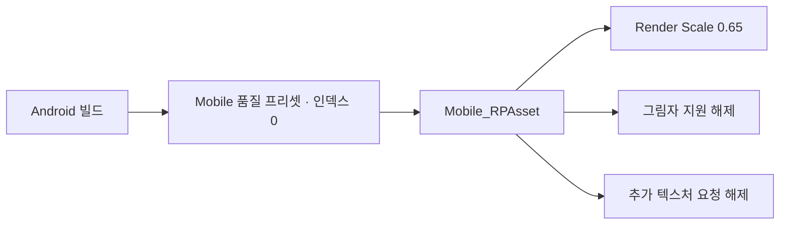

# 모바일 렌더 파이프라인 설정

**담당자:** 최성원 — Android 실기 프로파일링과 렌더링 설정 정리

## 코드

**QualitySettings:** Android가 Mobile 품질 프리셋을 선택합니다. **Mobile_RPAsset:** 해상도 스케일·추가 텍스처·그림자 옵션을 조절합니다. 설정 기반 개선이므로 존재하지 않는 최적화 스크립트를 만들지 않고 실제 에셋 값을 발췌했습니다.



```yaml
# ProjectSettings/QualitySettings.asset 중 선택 구조
m_PerPlatformDefaultQuality:
  Android: 0
# 인덱스 0의 Mobile 프리셋이 참조하는 파이프라인 GUID
customRenderPipeline: {fileID: 11400000, guid: 5e6cbd92db86f4b18aec3ed561671858, type: 2}

# Assets/Settings/Mobile_RPAsset.asset의 관련 필드
m_Name: Mobile_RPAsset
m_RequireDepthTexture: 0
m_RequireOpaqueTexture: 0
m_MSAA: 1
m_RenderScale: 0.65
m_MainLightShadowsSupported: 0
m_AdditionalLightShadowsSupported: 0
m_SoftShadowsSupported: 0
m_UseSRPBatcher: 1
```

## 생략 및 재구성한 내용

- 원본: 비공개 원본의 ProjectSettings/QualitySettings.asset, Assets/Settings/Mobile_RPAsset.asset 및 .meta. 기준 커밋: `0607414498b6af712b2c6225317c23dc2fa48ac7`.
- YAML의 서로 다른 문서·위치에 있는 필드만 모은 설명용 발췌입니다. 그대로 덮어쓸 완전한 Unity 설정 파일이 아닙니다.
- m_RenderScale 0.65는 출력 해상도 대비 내부 렌더 스케일입니다. 깊이·불투명 텍스처 요청과 주/추가 광원 그림자 지원이 꺼진 것을 확인했습니다. 모든 조명·모든 후처리가 꺼졌다는 의미는 아닙니다.
- 이는 저장된 최종 설정의 근거입니다. 이전 설정·실기 Profiler 캡처가 없어 프레임 개선 폭이나 각 옵션의 기여도를 입증하지 않습니다. 실기 성능 수치는 별도 측정 자료와 함께 제시해야 합니다.
- 맵 생성 최적화는 현재 포폴에서 제거됐으므로 이 최적화의 근거로 제시하지 않습니다. 맵 빌딩 샘플은 별도 기술 기여에 대응합니다.
