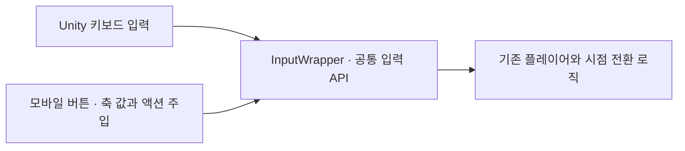

# PC·모바일 입력 통합과 UI 대응

**담당자:** 최성원 — 입력 래퍼·터치 버튼·Safe Area·언어별 UI 대응

## 코드

InputWrapper는 기존 입력 API와 터치 입력 사이의 **Adapter 역할**을 합니다. 별도 Adapter 인터페이스 계층이 아니라 정적 래퍼이며, 버튼 입력을 기존 플레이어 코드가 같은 방식으로 읽게 합니다.



**InputWrapper:** PC 입력과 모바일 주입 값을 같은 API로 제공합니다. **MobileButtons · MobileJumpNShift:** 터치 이동·점프·시점 전환을 전달합니다. **SafeAreaFitter:** 기기 안전 영역 안으로 UI를 이동합니다. **LocalizationAnimatorEvent:** 한국어용 Animator를 선택합니다.

```csharp
// InputWrapper: 기존 플레이어 로직은 플랫폼 대신 같은 입력 API만 참조
public static class InputWrapper
{
    private static bool useMobile;
    private static float horizontal, vertical;
    public static Action JumpAction, ShiftAction;
    public static void SetMobileMode(bool mobile) => useMobile = mobile;

    // 모바일 버튼이 주입한 축 값을 보관하고, 플레이어는 GetAxisRaw로 읽는다.
    public static void SetAxis(string axis, float value)
    {
        if (axis == "Horizontal") horizontal = value;
        if (axis == "Vertical") vertical = value;
    }

    public static float GetAxisRaw(string axis)
    {
        if (!useMobile) return Input.GetAxisRaw(axis);
        return axis switch
        {
            "Horizontal" => horizontal,
            "Vertical" => vertical,
            _ => Input.GetAxisRaw(axis)
        };
    }
}
```

```csharp
// MobileButtons: 드래그로 다른 방향 버튼에 넘어가면 이전 축부터 해제
private static void SwitchButton(MobileButtons next)
{
    if (activeButton == next) return;
    if (activeButton != null) InputWrapper.SetAxis(activeButton.axis, 0f);
    activeButton = next;
    if (activeButton != null)
        InputWrapper.SetAxis(activeButton.axis, activeButton.value);
}
public void OnPointerDown(PointerEventData data) => SwitchButton(this);
public void OnDrag(PointerEventData data)
{
    var target = data.pointerCurrentRaycast.gameObject;
    SwitchButton(target != null ? target.GetComponentInParent<MobileButtons>() : null);
}
// 손을 떼거나 버튼 밖으로 벗어나면 축을 0으로 만들어 이동이 남지 않게 한다.
public void OnPointerUp(PointerEventData data) => SwitchButton(null);
private void OnDisable()
{
    if (activeButton == this) SwitchButton(null);
}

// MobileJumpNShift: 누르기 입력을 플레이어·스테이지가 구독하는 액션으로 전달
public void OnPointerDown(PointerEventData data)
{
    if (mode == Mode.Jump) InputWrapper.JumpAction?.Invoke();
    else InputWrapper.ShiftAction?.Invoke();
}
```

```csharp
// SafeAreaFitter.ApplySafeArea: 카메라/Overlay Canvas 차이를 반영해 부모 좌표로 변환
public void ApplySafeArea()
{
    if (parentRect == null || canvas == null) return;
    var camera = canvas.rootCanvas.renderMode == RenderMode.ScreenSpaceOverlay
        ? null : canvas.rootCanvas.worldCamera;
    RectTransformUtility.ScreenPointToLocalPointInRectangle(
        parentRect, Screen.safeArea.min, camera, out Vector2 safeMin);
    RectTransformUtility.ScreenPointToLocalPointInRectangle(
        parentRect, Screen.safeArea.max, camera, out Vector2 safeMax);

    // 안전 영역과 UI 모서리를 모두 부모 로컬 좌표로 맞춘 뒤 경계를 비교한다.
    var corners = new Vector3[4];
    rect.GetWorldCorners(corners);
    Vector2 min = new Vector2(float.MaxValue, float.MaxValue);
    Vector2 max = new Vector2(float.MinValue, float.MinValue);
    foreach (var corner in corners)
    {
        Vector2 local = parentRect.InverseTransformPoint(corner);
        min = Vector2.Min(min, local);
        max = Vector2.Max(max, local);
    }
    safeMin.x += padding;
    safeMax.x -= padding;
    Vector2 offset = Vector2.zero;
    if (min.x < safeMin.x) offset.x = safeMin.x - min.x;
    else if (max.x > safeMax.x) offset.x = safeMax.x - max.x;
    if (min.y < safeMin.y) offset.y = safeMin.y - min.y;
    else if (max.y > safeMax.y) offset.y = safeMax.y - max.y;
    // UI 크기는 유지하고 안전 영역을 벗어난 만큼만 위치를 보정한다.
    rect.anchoredPosition += offset;
}
```

```csharp
// LocalizationAnimatorEvent.OnEnable: 한국어를 사용하는 화면의 전용 애니메이션 선택
private void OnEnable()
{
    var locale = LocalizationSettings.SelectedLocale;
    if (locale != null && locale.Identifier.Code == "ko")
        animator.runtimeAnimatorController = korAnimationController;
}
```

**Localization 에셋:** 번역 문구는 Shared Data의 공통 키·ID와 locale별 문자열 테이블로 관리합니다. 아래는 실제 같은 ID의 두 번역을 발췌한 것이며, UI 컴포넌트 바인딩과 자동 번역 알고리즘 구현을 보여주는 코드는 아닙니다.

```yaml
# New Table Shared Data.asset: 문구 키와 공통 엔트리 ID
m_TableCollectionName: New Table
m_Entries:
- m_Id: 407357644800
  m_Key: stage 1-1

---
# New Table_ko.asset: 같은 ID의 한국어 번역
m_LocaleId:
  m_Code: ko
m_TableData:
- m_Id: 407357644800
  m_Localized: 같은 색의 문 앞에 네모를 위치시켜보세요.

---
# New Table_en.asset: 같은 ID의 영어 번역
m_LocaleId:
  m_Code: en
m_TableData:
- m_Id: 407357644800
  m_Localized: Try placing the square in front of the matching colored door.
```

## 생략 및 재구성한 내용

- 추가 원본: `Assets/Language/New Table Shared Data.asset`, `New Table_ko.asset`, `New Table_en.asset`. 한국어 Unicode 이스케이프는 읽기 쉽게 풀었고 Unity YAML의 공통 메타데이터는 생략했습니다.

- 원본: `Assets/Scripts/InputWrapper.cs`, `UI/MobileButtons.cs`·`MobileJumpNShift.cs`·`MobileUIManager.cs`·`LocalizationAnimatorEvent.cs`, `Mobile/SafeAreaFitter.cs`·`Joystick.cs`. 기준 커밋: `0607414498b6af712b2c6225317c23dc2fa48ac7`.
- InputWrapper의 필드 이름을 줄였고 다른 입력 흐름은 유지했습니다. 각 코드 블록은 별도 클래스의 발췌입니다.
- GameManager의 모바일 빌드 분기가 모드를 켜고 UI를 활성화합니다. 모든 입력을 래퍼로 완전히 통합한 구현은 아닙니다.
- MobileButtons의 드래그 임계값 설정과 필드·인터페이스 선언, MobileUIManager의 시점별 아이콘·버튼 표시를 생략했습니다. 
- Safe Area의 초기화와 해상도·safeArea 변경 감지는 생략했습니다. 
- 로컬라이징 파일의 실제 이름은 LocalizationAnimatorEvent입니다. OnEnable 시 한국어 Animator를 선택하는 부분만 보여줍니다.
- using·Unity UI/EventSystem·Localization 패키지·Canvas·카메라·원본 필드와 씬 설정이 필요한 설명용 발췌입니다.
