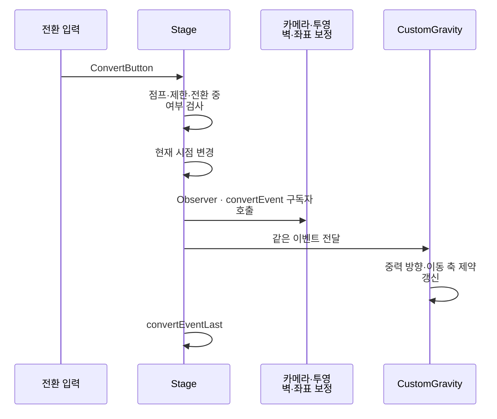

# 시점 전환과 커스텀 중력

**담당자:** 최성원 — 시점 전환·투영 벽·중력 상태 연동

## 코드



**Stage:** 카메라·투영 벽·좌표 보정을 이벤트로 연결합니다. **CustomGravity:** 시점에 맞춰 중력 방향과 Rigidbody 이동 축을 바꿉니다. **GameManager:** 현재 시점과 플레이 상태를 보관합니다.

Observer 패턴으로 전환 알림과 반응을 분리합니다. CustomGravity의 enum 분기는 상태 관리이지만, 상태별 객체에 동작을 위임하는 GoF State 패턴은 아닙니다.

```csharp
// Stage.Awake: 전환 시 처리할 기능을 등록. 각 컴포넌트도 같은 이벤트를 구독한다.
private void Awake()
{
    convertEvent += CallCameraRotate;
    convertEvent += ProjectionSetting;
    convertEvent += PlayerConvertReposition;
    InputWrapper.ShiftAction += ConvertButton;
}

// Stage.ConvertButton: 점프·제한 영역·전환 연출 중에는 요청 거부
private void ConvertButton()
{
    if (!data.conversionActive || isActing || restrict) return;
    if (player1.GetComponent<PlayerJump>().isJumping) return;
    if (data.player2Exist && player2.GetComponent<PlayerJump>().isJumping) return;

    GameManager.instance.isSideView = !GameManager.instance.isSideView;
    // 한 구독자의 예외가 나머지 전환 처리를 막지 않게 순서대로 호출한다.
    foreach (Action handler in convertEvent?.GetInvocationList()
        ?? Array.Empty<Delegate>())
    {
        try { handler(); }
        catch (Exception error) { Debug.LogException(error); }
    }
    // 일반 전환 구독자 처리가 끝난 뒤 실행할 후속 단계를 분리한다.
    convertEventLast?.Invoke();
}

// 전환할 시점에 미리 준비된 투영 벽·제한 영역만 활성화
private void ProjectionSetting()
{
    bool side = GameManager.instance.isSideView;
    projectionWallParentXY.gameObject.SetActive(side);
    projectionWallParentXZ.gameObject.SetActive(!side);
    restrictionSide.gameObject.SetActive(side);
    restrictionTop.gameObject.SetActive(!side);
}

private void OnDestroy()
{
    convertEvent -= CallCameraRotate;
    convertEvent -= ProjectionSetting;
    convertEvent -= PlayerConvertReposition;
    InputWrapper.ShiftAction -= ConvertButton;
}
```

```csharp
// CustomGravity: 물체별 중력과 축 제한을 한 상태로 갱신
private void SetGravity(GravityState state)
{
    gravityState = state;
    _currentGravity = state switch
    {
        GravityState.invertG => new Vector3(0f, 0f, 9.81f),
        GravityState.convertG => new Vector3(0f, -9.81f, 0f),
        _ => new Vector3(0f, 0f, -9.81f)
    };
    down = _currentGravity.normalized;
    up = -down;
    // 현재 2D 플레이 평면의 깊이 축을 고정하고 나머지 축에서 중력을 받는다.
    rigid.constraints = RigidbodyConstraints.FreezeRotation
        | (state == GravityState.convertG
            ? RigidbodyConstraints.FreezePositionZ
            : RigidbodyConstraints.FreezePositionY);
}

// CustomGravity.ConvertAction: 사이드뷰 진입 전의 중력을 기억해 탑뷰 복귀 시 복원
private void ConvertAction()
{
    if (GameManager.instance.isSideView)
    {
        // 탑뷰의 기본·반전 중력을 기억해야 사이드뷰에서 돌아올 때 유지할 수 있다.
        _stateBeforeConvert = gravityState;
        SetGravity(GravityState.convertG);
    }
    else SetGravity(_stateBeforeConvert);
}

// Unity 기본 중력 대신 물체별 방향으로 가속도 적용
private void FixedUpdate()
{
    if (GameManager.instance.isPlaying)
        rigid.AddForce(_currentGravity, ForceMode.Acceleration);
}
```

## 생략 및 재구성한 내용

- 원본: `Assets/Scripts/Stage/Stage.cs`, `CustomGravity.cs`, `GameManager.cs`. 기준 커밋: `0607414498b6af712b2c6225317c23dc2fa48ac7` (`1Seong/2024WinterProject2`).
- Stage의 ConvertButton과 ConvertView를 합쳤습니다. HubStage 예외·시작 이벤트·클리어 UI는 생략했습니다.
- CustomGravity의 상태 setter와 SetToDefault/Invert/Convert를 SetGravity로 모았습니다.
- 원본의 중력 반전 이벤트·GPause·Movable 그룹 등록, 카메라 회전 코루틴·탑뷰 좌표 보정·RotateTransparent/Transparent의 페이드 처리는 생략했습니다. 
- Stage와 CustomGravity의 블록은 서로 다른 클래스의 발췌입니다. CustomGravity의 Stage.convertEvent 구독과 필드 초기화, enum·씬·prefab 등은 원본 의존성이며 단독 실행되지 않습니다.
